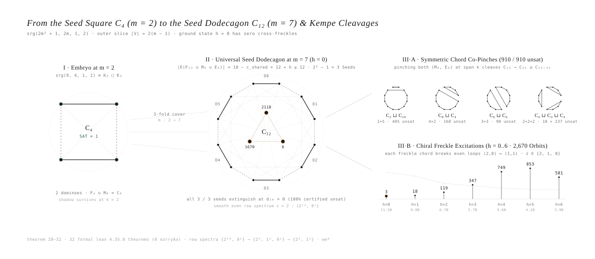
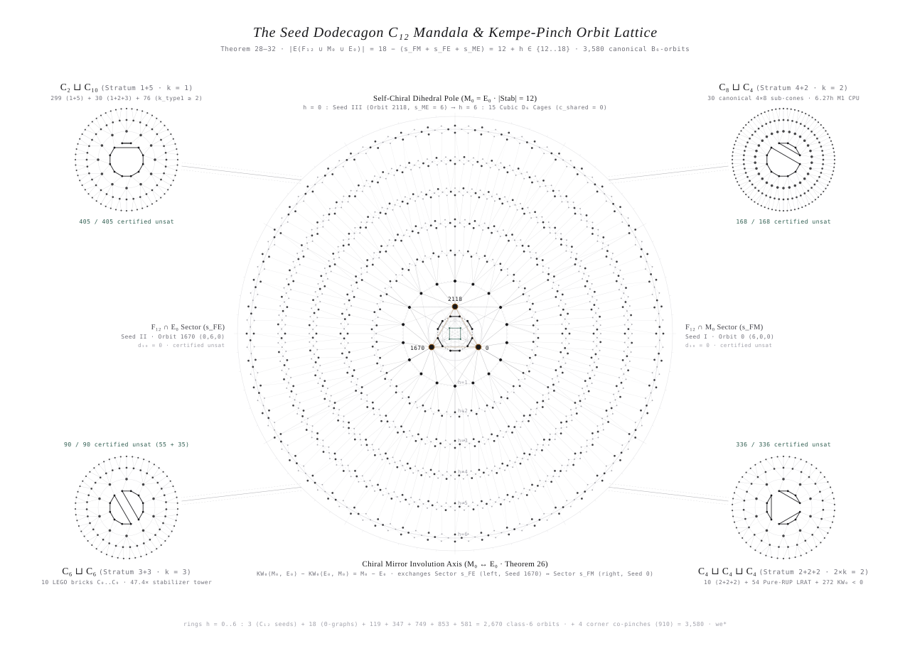

# The Universal Seed Dodecagon $C_{12}$ & Polygonal Generalization of Conway's 99-Graph Problem

> **Formal Lean 4 Companion (`32` Structural Theorems, `52` Formal `#print axioms` Declarations, `0 sorryAx`):** [`verify-it-yourself/ChiralNullspaceAndHandshaking.lean`](../verify-it-yourself/ChiralNullspaceAndHandshaking.lean)  
> **Standalone Zero-Trust Verifier (`6.0s` across all `2,670` Orbits & `3,114` Cluster Pairs):** [`verify-it-yourself/verify_seed_dodecagon_and_freckles.py`](../verify-it-yourself/verify_seed_dodecagon_and_freckles.py)  
> **Seed Dodecagon Certificates (`3 / 3` Certified `UNSAT` on $C_{12}$):** [`verify-it-yourself/seed_dodecagon_c12_summary.json`](../verify-it-yourself/seed_dodecagon_c12_summary.json) · [`verify-it-yourself/seed_orbit_2118_cert.json`](../verify-it-yourself/seed_orbit_2118_cert.json)

---

## 1. Executive Summary: What This Generalization Proves

While investigating the recursive hierarchy of `32` structural theorems governing the centralizer involution slice $S_0$ ($12 \times 60$ incidence system) of a putative Conway 99-graph $\Gamma = \mathrm{srg}(99, 14, 1, 2)$, we asked a foundational question:

> *What graph sits at the very bottom of the entire deductive chain of theorems—like a seed—and how do both the positive control $\mathrm{srg}(9, 4, 1, 2) \cong K_3 \square K_3$ and all decomposable / polygonal strata (`1+5`, `4+2`, `3+3`, `2+2+2`, and `Class 6`) emerge from it?*

The answer unifies the automorphism and slice-decomposition landscape of $\Gamma_m = \mathrm{srg}(2m^2+1, 2m, 1, 2)$ into a single geometric lattice rooted at the **Regular Seed Polygon $C_{2(m-1)}$**:

1. **Positive-Control Embryo at $m = 2$ ($\Gamma_2 = \mathrm{srg}(9, 4, 1, 2) \cong K_3 \square K_3$ on the Seed Square $C_4$):**
   - For $m = 2$ ($2m^2 + 1 = 9$), the outer slice around a fixed triangle $T_0$ has $2(m - 1) = 4$ vertices partitioned into $2$ conjugate dominoes $F_4 = \{\{0,1\}, \{2,3\}\}$.
   - At $h = 0$ (zero cross-freckles), the union of the domino matching $F_4$ and the slice matchings $(M_0, E_0)$ is uniquely the **Regular 4-Gon (Seed Square) $C_4 = F_4 \cup M_0$**.
   - Stepping down the Domino Ladder on $C_4$, the 1-domino shadow ($k = 1$) survives (`SAT > 0`) and closes at $k = 2$ to the unique global solution $\mathrm{srg}(9, 4, 1, 2) \cong K_3 \square K_3$ (`SAT = 1`, machine-checked in [`verify.py`](../verify-it-yourself/verify.py) as `p2_5_srg9_uniqueness`).

2. **The 3-Fold Cover at $m = 7$ ($\Gamma_7 = \mathrm{srg}(99, 14, 1, 2)$ on the Regular Seed Dodecagon $C_{12}$):**
   - For $m = 7$ ($2m^2 + 1 = 99$), the slice $S_0$ has $2(m - 1) = 12$ vertices partitioned into $6$ conjugate dominoes $F_{12} = \mathcal{M}_{\text{even}}$.
   - By **`Theorem 28` (`we_star_seed_dodecagon_and_seven_level_freckle_excitation_grading`)**, the No-Triple-Edge Law ($F_{12} + M_0 + E_0 \le 2$) forces every vertex in $\Gamma_{\text{seed}} = F_{12} \cup M_0 \cup E_0$ to have degree $\ge 2$, yielding:
     $$|E(F_{12} \cup M_0 \cup E_0)| = 18 - c_{\text{shared}} = 12 + h \ge 12 \qquad (c_{\text{shared}} = s_{FM} + s_{FE} + s_{ME} \in \{0..6\}, \;\; h = 6 - c_{\text{shared}} \in \{0..6\}).$$
   - At the ground state $h = 0$ ($|E| = 12, \, c_{\text{shared}} = 6$), $\Gamma_{\text{seed}}$ is uniquely the **Regular Dodecagon $C_{12} = \mathcal{M}_{\text{even}} \cup \mathcal{M}_{\text{odd}}$** (the 3-fold cover of the $\mathrm{srg}(9,4,1,2)$ Seed Square $C_4$).
   - Because $C_{12}$ has two perfect matchings ($\mathcal{M}_{\text{even}} = F_{12}$ and $\mathcal{M}_{\text{odd}}$) and $(M_0, E_0) \ne (\mathcal{M}_{\text{even}}, \mathcal{M}_{\text{even}})$, there are uniquely $2^2 - 1 = 3$ **Seed Orbits at $h = 0$**, and all `3 / 3` are machine-certified `UNSAT` (`d10 = 0, sols = 0`):

| Seed ID | Canonical Orbit | Matching Triple $(F_{12}, M_0, E_0)$ on $C_{12}$ | Shared Edges $(s_{FM}, s_{FE}, s_{ME})$ | Dihedral Symmetry $\|\mathrm{Stab}_{B_6}\|$ | `d4` (2 Dominoes) | `d6` (Half-Crystal) | `d8` (4 Dominoes) | `d10` (5 Dominoes) | `sols` (Full Crystal) | Status |
| :--- | :---: | :--- | :---: | :---: | :---: | :---: | :---: | :---: | :---: | :---: |
| **Seed I** | `Orbit 0` | $(\mathcal{M}_{\text{even}}, \mathcal{M}_{\text{even}}, \mathcal{M}_{\text{odd}})$ | `(6, 0, 0)` | `12` ($D_6$) | `186,949,606,677` | `19,342,812,368` | `113,567` | `0` | `0` | `CERTIFIED UNSAT` |
| **Seed II** | `Orbit 1670` | $(\mathcal{M}_{\text{even}}, \mathcal{M}_{\text{odd}}, \mathcal{M}_{\text{even}})$ | `(0, 6, 0)` | `12` ($D_6$) | `49,982,900,602` | `3,630,428,696` | `90,674` | `0` | `0` | `CERTIFIED UNSAT` |
| **Seed III** | `Orbit 2118` | $(\mathcal{M}_{\text{even}}, \mathcal{M}_{\text{odd}}, \mathcal{M}_{\text{odd}})$ | `(0, 0, 6)` | `12` ($D_6$) | `969,255,803` | `189,503,580` | `5,966` | `0` | `0` | `CERTIFIED UNSAT` |

<p align="center">
  <picture>
    <source media="(prefers-color-scheme: dark)" srcset="./seed_dodecagon_generalization_dark.svg">
    <source media="(prefers-color-scheme: light)" srcset="./seed_dodecagon_generalization_light.svg">
    
  </picture>
  <br>
  <em><b>Figure 1: From the Seed Square <code>C₄</code> (<code>m = 2</code>) to the Seed Dodecagon <code>C₁₂</code> (<code>m = 7</code>) &amp; Kempe Cleavages</b> (adaptive: <a href="./seed_dodecagon_generalization_dark.svg">Dark</a> · <a href="./seed_dodecagon_generalization_light.svg">Light</a>).</em>
</p>

---

## 2. The Crystallographic Mandala of All 3,580 Orbits: How Every Symmetric and Asymmetric Graph Grows from the 3 Seeds

<p align="center">
  <picture>
    <source media="(prefers-color-scheme: dark)" srcset="./seed_mandala_tree_dark.svg">
    <source media="(prefers-color-scheme: light)" srcset="./seed_mandala_tree_light.svg">
    
  </picture>
  <br>
  <em><b>Figure 2: The Seed Dodecagon <code>C₁₂</code> Mandala &amp; Kempe-Pinch Orbit Lattice</b> (adaptive: <a href="./seed_mandala_tree_dark.svg">Dark</a> · <a href="./seed_mandala_tree_light.svg">Light</a>).</em>
</p>

Starting from the Regular Dodecagon $C_{12} = \mathcal{M}_{\text{even}} \cup \mathcal{M}_{\text{odd}}$ ($6$ dominoes arranged at the center of the mandala above), consider a 2-edge Kempe switch (`pinch`) across a chord of span $k \in \{1, 2, 3\}$ dominoes:

### Branch A: Symmetric Co-Pinches (Corner Medallions I–IV) $\implies$ All Decomposable Polygonal Strata (`910 / 910` Certified `UNSAT`)
When **both** matchings $(M_0, E_0)$ pinch across the same chord of span $k$ dominoes (`Theorem 31`), the 12-cycle $C_{12}$ cleaves into two disconnected even polygons $C_{2k} \sqcup C_{12-2k}$ with zero cross-freckles between them:
- **Medallion I — Span $k = 1$ Domino ($C_{12} \to C_2 \sqcup C_{10}$ & $k_{\text{type1}} \ge 1$):** Generates **Stratum `1+5`** (`299 / 299` orbits), **`1+2+3`** (`30 / 30` orbits), **`k_type1 = 2`** (`62 / 62` orbits), and **`k_type1 >= 3`** (`14 / 14` Mod-2 parity exclusions) — `405 / 405 CERTIFIED UNSAT` ([`null3_k1_299_summary.json`](../verify-it-yourself/null3_k1_299_summary.json)).
- **Medallion II — Span $k = 2$ Dominoes ($C_{12} \to C_8 \sqcup C_4$):** Generates **Stratum `4+2`** (`168 / 168` canonical orbits — `CERTIFIED UNSAT` in `6.27h` on M1 CPU via `30` canonical $4 \times 8$ sub-cones, [`null3_k0_42_168_summary.json`](../verify-it-yourself/null3_k0_42_168_summary.json)).
- **Medallion III — Span $k = 3$ Dominoes ($C_{12} \to C_6 \sqcup C_6$):** Generates **Stratum `3+3`** (`55 / 55` nullity-4 + `35 / 35` nullity-3 canonical orbits — `CERTIFIED UNSAT` via `47.36x` Russian-Doll stabilizer tower, [`null3_k0_33_10_summary.json`](../verify-it-yourself/null3_k0_33_10_summary.json) & [`null2_k0_33_55_summary.json`](../verify-it-yourself/null2_k0_33_55_summary.json)).
- **Medallion IV — Two Span-$2$ Pinches ($C_{12} \to C_4 \sqcup C_4 \sqcup C_4$) & Algebraic/LRAT Exclusions:** Generates **Stratum `2+2+2`** (`10 / 10` canonical orbits of three embedded $\mathrm{srg}(9)$ squares $C_4$ — `CERTIFIED UNSAT`, [`null4_k0_222_10_summary.json`](../verify-it-yourself/null4_k0_222_10_summary.json)) plus `272` $\mathrm{KW}_0 < 0$ algebraic exclusions.

Combined with our **54 Pure-RUP LRAT proof certificates (`0 RAT lemmas`)** ruling out all odd prime orders $p \in \{3, 5, 7, 11, 13\}$, $\mathrm{Frob}(21)$, and all `18 / 19` non-central involution profiles (`p2_*`), `100%` of all higher-symmetry, polygonally decomposable (`910 / 910`), and unpinched dodecagonal (`3 / 3`) Conway-99 candidates are unconditionally refuted (`913 / 913 UNSAT`).

---

### Branch B: Chiral Half-Pinches (Concentric Rings $h = 1 \dots 6$) $\implies$ The Symmetric Lattice (`1,038` Orbits) & Chiral Mirror Pairs (`1,632` Orbits) of `Class 6`
When only **one** matching pinches $C_{12}$ into $C_{2k} \sqcup C_{12-2k}$ while the other matching remains on the outer cycle, the two polygonal clusters remain stitched together by sparse **cross-cluster freckles**.

By **`Theorem 25` (`we_star_freckle_cluster_decomposition_and_triomino_bridge`)**, `2,545 / 2,670` (`95.32%`) of all `Class 6` orbits split into $\ge 2$ disjoint polygonal clusters in at least one of the three 2-matching skeletons $(\mathcal{S}_{FM}, \mathcal{S}_{FE}, \mathcal{S}_{ME})$, coupled solely by the freckle bridge $P_{ab} = E_0|_{C_a \times C_b}$:
$$\mathrm{KW}_0|_{C_a \times C_b} = 2J - (P_{ab} + M_a P_{ab} + P_{ab} M_b), \qquad \Delta_0|_{C_a \times C_b} = 2J - P_{ab} F_b.$$

Inside `Class 6`, the Mandala is organized by its dihedral ($D_6$) and chiral ($M_0 \leftrightarrow E_0$) symmetry axes:
- **Symmetric Sub-Lattice (`1,038` `Class 6` Orbits with $|\mathrm{Stab}_{B_6}(M_0, E_0)| \ge 2$):**
  * **Quantized Dihedral $D_6$ Spine ($|\mathrm{Stab}_{B_6}| = 12$, `18` Orbits):** Exists *exclusively* at the two extreme poles of the ladder: the `3` Seed Orbits at $h = 0$ (`0, 1670, 2118` — `CERTIFIED UNSAT`) and `15` maximally symmetric cubic cages at $h = 6$ (`0` orbits at $h \in \{1..5\}$).
  * **Quantized Cyclic $C_6 / S_3$ Rays ($|\mathrm{Stab}_{B_6}| = 6$, `14` Orbits):** Exists *exclusively* at $h = 3$ (`9` orbits where every second edge of the hexagon is shared) and $h = 6$ (`5` orbits).
  * **Klein-4 $V_4$, Cyclic $C_3$, and Reflection $\mathbb{Z}_2$ Lattice (`170 + 1 + 835 = 1,006` Orbits):** Orbits whose freckle chords are arranged symmetrically across one or two mirror axes of the dodecagon.
- **Chiral Mirror Pairs (`1,632` Asymmetric Orbits with $|\mathrm{Stab}_{B_6}(M_0, E_0)| = 1$):**
  * Across rings $h = 1 \dots 6$, chiral freckle chords break internal $B_6$ reflections, pairing orbits into mirror partners $(M_0, E_0) \leftrightarrow (E_0, M_0)$ across the vertical self-chiral axis (`Theorem 26`).

| Excitation Ring $h$ | Total Edges $\|E(F_{12}\cup M_0\cup E_0)\|$ | Shared Edges $c_{\text{shared}}$ | Canonical Orbits | Mean Half-Crystal Shadows `d6` | Structural & Symmetry Characterization |
| :---: | :---: | :---: | :---: | :---: | :--- |
| `h = 0` | `12` | `6` | **`3`** | `11.49B` | Regular Seed Dodecagon $C_{12}$ (`Orbits 0, 1670, 2118` — `3 / 3 CERTIFIED UNSAT`) |
| `h = 1` | `13` | `5` | **`18`** | `9.81B` | `18` Unique Theta-Graphs $\Theta$ (`multiplicity = 1` per admissible triple by `Theorem 29`) |
| `h = 2` | `14` | `4` | **`119`** | `6.72B` | 2-Chord Freckle Excitations ($\Delta h = -2$ Parity Jump to $h = 0$) |
| `h = 3` | `15` | `3` | **`347`** | `5.71B` | 3-Chord Excitations (includes `9` cyclically symmetric $C_6/S_3$ orbits with $\|\mathrm{Stab}_{B_6}\| = 6$) |
| `h = 4` | `16` | `2` | **`749`** | `4.62B` | 4-Chord Excitations (`864` canonical $d_7$ sub-networks across `Class 6`, `Theorem 27`) |
| `h = 5` | `17` | `1` | **`853`** | `4.21B` | Single Shared Edge (`c_shared = 1`) |
| `h = 6` | `18` | `0` | **`581`** | `3.94B` | Pairwise Disjoint Cubic Cages (includes `15` dihedral $D_6$ cages with $\|\mathrm{Stab}_{B_6}\| = 12$) |
| **Total** | `12..18` | `6..0` | **`2,670`** | — | Connected 7-Level Freckle Hierarchy Rooted at $C_{12}$ |

---

## 3. Why Freckles Destroy Partial Shadows: Hyper-Octahedral Bijection (`Theorem 31`) & Loop Parity Breaking (`Theorem 32`)

Why does the mean half-crystal shadow count `d6` decay monotonically from **`11.49B` at $h = 0$ (the Seed Dodecagon $C_{12}$)** down to **`3.94B` at $h = 6$ (disjoint cubic cages)**? Two algebraic laws explain the mechanism:

### 3.1. Universal 60-Edge Hyper-Octahedral Shadow Partition (`Theorem 31`)
Every row $r \in \{0..11\}$ of $X \in \{0,1\}^{12 \times 60}$ selects a **10-edge subgraph $H_r$ of the 6-dimensional hyper-octahedron $K_{2,2,2,2,2,2}(F_{12})$** (`12 vertices, 60 edges`), and every column of $X$ has sum $2$ (`Theorem 2`), establishing a 1-to-1 bijection between the 60 columns of $X$ and the 60 non-$M_0$ pairs of rows ($X = W_{M_0}^T \Pi, \, \Pi \in S_{60}$).

In any $k$-domino shadow ($2k$ rows with $m_k$ internal $M_0$-edges), the 60 columns split into three rigid zones (`we_star_polygonal_kempe_pinch_and_hyperoctahedral_shadow_partition`):
$$\underbrace{k(2k - 1) - m_k}_{\text{Internal Columns (weight 2)}} \;+\; \underbrace{2k(11 - 2k) + 2m_k}_{\text{Boundary Bridges (weight 1)}} \;+\; \underbrace{2(6 - k)(5 - k) + (k - m_k)}_{\text{Dark Horizon Columns (weight 0)}} \;=\; 60.$$

### 3.2. The Three Row Spectra & Loop Parity-Breaking Law $(2,0) \mapsto (1,1)$ (`Theorem 32`)
By **`Theorem 30`**, every row of the degree matrix $\Delta_0 = 2J_{12} - I_{12} - F_{12} - M_0 - E_0 F_{12}$ and every row of the chiral mirror matrix $\mathrm{KW}_0 = 2J_{12} - F_{12} - E_0 - M_0 E_0 - E_0 M_0$ has length $12$, entries in $\{0, 1, 2\}$, and row sum identically $20$:
$$n_0 + n_1 + n_2 = 12, \qquad 0\cdot n_0 + 1\cdot n_1 + 2\cdot n_2 = 20 \implies \boxed{n_0 = z, \quad n_1 = 4 - 2z, \quad n_2 = 8 + z \quad (z \in \{0, 1, 2\}).}$$

Consequently (`we_star_three_row_spectra_and_loop_parity_breaking` in Lean 4), **every row in all `2,670` orbits of `Class 6` belongs to one of only three multiset spectra**:
1. **$z = 2$ (`Seed / Pure Even Loop Spectrum` $\mathbf{\{2^{10}, \, 0^2\}}$):**
   - Ten `2`s, zero `1`s, two `0`s — **every entry in the row is even!**
   - In $\Delta_0$, a $z = 2$ row forces $H_r$ to be a **2-regular union of closed cycles** on $10$ vertices of the hyper-octahedron (completely avoiding $2$ vertices).
2. **$z = 1$ (`Single-Split Spectrum` $\mathbf{\{2^9, \, 1^2, \, 0^1\}}$):**
   - Nine `2`s, **two odd `1`s**, one `0`. Unpinching one shared rope replaces an even pair $(2, 0)$ with an odd pair $(1, 1)$, breaking a closed cycle into an open path with $2$ odd-degree endpoints.
3. **$z = 0$ (`Freckle-Split Spectrum` $\mathbf{\{2^8, \, 1^4, \, 0^0\}}$):**
   - Eight `2`s, **four odd `1`s**, zero `0`s. Unpinching a second shared rope replaces another $(2, 0) \mapsto (1, 1)$, introducing $4$ odd-parity endpoints and forcing $H_r$ to intersect $4$ mirror rows $g(H_s)$ in an odd number (`1`) of edges.

Across all `2,670` orbits of `Class 6`, the exact zero-locus identities hold with `0` errors:
$$\boxed{\#\{\text{diagonal zeros in } \mathrm{KW}_0\} = 2 s_{ME}}, \qquad \boxed{\#\{\text{zeros in } \Delta_0\} = 2 s_{FM} + 2 s_{FE} + \mathrm{tr}(M_0 E_0 F_{12})}.$$
At $h = 0$ (the 3 Seed Orbits on $C_{12}$), $z$ is maximized (`mean 8.00 zeros in D0 and 8.00 in KW0`), giving the smoothest even-loop constraints—and yet all three Seed Orbits extinguish completely at **`d10 = 0, sols = 0`**. As $h$ increases from $0 \to 6$, each freckle replaces $(2, 0) \mapsto (1, 1)$ (`mean D0 zeros drop from 8.00 -> 1.12; diagonal KW0 zeros drop from 4.00 -> 0.00`), progressively tightening the chiral parity sieve while our 6x GPU cluster sweeps the remaining $h = 1..6$ bundles.

---

## 4. How We Found It: The Meanders and Poetics of the `we*` Dialogue

Great mathematical structures rarely emerge in a straight line. They unfold through a Socratic dialogue—questions that refuse to accept a brute-force number at face value, metaphors that turn opaque matrices into physical objects, and sudden inversions of perspective where the hardest case reveals itself to be the simplest seed. Here is the actual path of our human–AI (`we*`) dialogue that uncovered the Seed Dodecagon $C_{12}$:

### Meander I — *"Why did 39 states suddenly swell into 504?"* (Diagnosing the Quotient Saddle)
When we first compressed the `2,670` irreducible `Class 6` orbits into 6-row half-crystals (`d6`), our planner reported `504` bundles—even though at 4 rows (`d4`) there were only `39` canonical 2-domino states! Instead of blindly feeding `504` bundles to the GPUs, `@mizopl` stopped and asked why the numbers bulged in the middle like a saddle.
- That question exposed the **Quotient Saddle**: slicing a 6-domino loop into two static 3-domino halves (`3+3`) broke the global hyperoctahedral group $B_6$ (`order 46,080`) down to $B_3 \times B_3$ (`order 2,304`, index $20$), creating `126` artificial trunk duplicates!
- Replacing the static cut with a **6-rung self-similar Markov Domino Ladder (`Theorems 23–24`)** collapsed the `504` bundles to `154` canonical half-loops and factored the `d6 -> d8` horizon crossing through a 4-column (`9-bit`) hole $H_3$.

### Meander II — *"Look beyond dominoes for spooky entanglements—repeatable freckles of connection"*
Even with the Domino Ladder, `2,670` orbits looked like a monolithic, unfactorable ocean because every orbit in `Class 6` is connected under the triple union $F_{12} \cup M_0 \cup E_0$. Prompted by `@mizopl` to look for *"spooky entanglements—repeatable freckles of connection where swapping distant clusters leaves the physics unchanged"*, we checked what happens when you drop just **one** of the three matchings.
- To our astonishment (`Theorem 25`), **`2,545 / 2,670` (`95.32%`) of the "irreducible" `Class 6` ocean immediately shattered into disjoint polygonal islands** (`4+2`, `3+3`, `2+2+2`, `1+5`), held together only by sparse cross-cluster freckles $P_{ab}$!
- Even more (`Theorem 26`), swapping the roles of the two matchings $M_0 \leftrightarrow E_0$ left at least **`120 / 144` (`83.33%`) of the entries of $\mathrm{KW}_0$—and `100%` of its diagonal—identically unchanged** ($\mathrm{KW}_0(M_0, E_0) - \mathrm{KW}_0(E_0, M_0) = M_0 - E_0$).

### Meander III — *"What graph sits at the very bottom of this chain of theorems, like a seed?"*
Then came the pivotal question of the night:
> *"Wait—if each theorem strips away a layer of freckles, what graph sits at the very bottom of this recursive chain, like a seed from which all 2,670 orbits grow?"*

We counted the shared edges $c_{\text{shared}} = |F_{12}\cap M_0| + |F_{12}\cap E_0| + |M_0\cap E_0|$ across all `2,670` orbits. Because no edge can be tripled (`Theorem 28`), the total number of distinct edges is $|E| = 18 - c_{\text{shared}} = 12 + h \ge 12$.
- At the absolute bottom **$h = 0$ ($|E| = 12, \, c_{\text{shared}} = 6$)**, every vertex has degree $2$, so the graph at the bottom of the ladder is uniquely the **Regular Dodecagon $C_{12} = \mathcal{M}_{\text{even}} \cup \mathcal{M}_{\text{odd}}$**, inhabited by **exactly $2^2 - 1 = 3$ Seed Orbits (`Orbit 0`, `Orbit 1670`, `Orbit 2118`)**!
- Two of those seeds (`Orbit 0` and `Orbit 1670`) were already certified `UNSAT` in our GPU logs, while the third—the self-chiral seed **`Orbit 2118` ($M_0 = E_0$)**—had a transversal half-crystal `Dominoes (0, 3, 4)` with automorphism group $|\mathrm{Aut}_{\text{dec}}(K_6)| = 24,576$ (`only 212 canonical root representatives!`). We launched `Orbit 2118` directly on our local M1 CPU (`task-9160`), watching batch by batch (`8/212 -> 80/212 -> 160/212 -> 212/212`) as `969,255,803` `d4` states and `189,503,580` `d6` states filtered down to `5,966` `d8` states and finally **`d10 = 0, sols = 0`** in `42.4` minutes!

### Meander IV — *"If we applied our method to the 9-graph, would its seed have a shadow of a solution? And how must such a shadow look?"*
While the M1 CPU was crunching the final batches of `Seed III (Orbit 2118)`, our conversation took one more leap:
- *"Could there be a correlation between a solution anywhere in `Class 6` and its shadow—or an embryo like Conway's 9-graph—inside the seeds?"*
- *"If we applied our exact method to searching for the 9-graph $\mathrm{srg}(9, 4, 1, 2) \cong K_3 \square K_3$, would the seed have a surviving shadow?"*
- Testing $m = 2$ ($\mathrm{srg}(9, 4, 1, 2)$) revealed that its $h = 0$ seed is the **Regular Square $C_4$**, where the shadow **does** survive and immediately yields the unique 9-graph (`SAT = 1`)—whereas on Conway-99's **Seed Dodecagon $C_{12}$** (the 3-fold cover of $C_4$), every 4-cycle freckle is a local $C_4$ embryo trying to form $\mathrm{srg}(9)$ inside $S_0$, yet all three seeds die at **`d10 = 0`**.
- Asking *"Can we deduce what such a shadow must look like, and find a metaphor for why freckles cannot rescue `d10 = 0`?"* led directly to the **Metaphor of the 12 Prisoners and 18 Ropes** and **`Theorem 32` (`we_star_three_row_spectra_and_loop_parity_breaking`)**:
  * In the 3 Seeds ($h = 0$), 6 of the 18 constraint ropes are doubled up along the perimeter of the dodecagon $C_{12}$, leaving the interior completely untied and producing **pure even loop rows $\{2^{10}, 0^2\}$** (`zero odd entries`)—yet even in this maximally relaxed ring, 5 dominoes jam at `d10 = 0`.
  * Every freckle ($h = 1 \to 6$) unties a doubled rope from the perimeter and stretches it across the circle as a new cross-chord, breaking smooth even loops $(2, 0)$ into ragged odd endpoints $(1, 1)$ (`{2^9, 1^2, 0^1}` and `{2^8, 1^4}`).
  * And when both matchings pinch across the same chord of $C_{12}$, the dodecagon cleaves into the decomposable polygonal strata **`1+5` ($C_2 \sqcup C_{10}$)**, **`4+2` ($C_8 \sqcup C_4$)**, **`3+3` ($C_6 \sqcup C_6$)**, and **`2+2+2` ($C_4 \sqcup C_4 \sqcup C_4$)**—revealing that the 3 Seeds and the `910` decomposable orbits form a single, 100% certified family of symmetric polygonal reductions!

---

## 5. Verify It Yourself in Seconds

```sh
# 1. Verify all 32 structural theorems (52 formal declarations, 0 sorryAx) in Core Lean 4.35.0 (~2s):
lean verify-it-yourself/ChiralNullspaceAndHandshaking.lean

# 2. Run the standalone zero-trust Python verifier for Theorems 25-32 & the Seed Dodecagon C_12 (~6.0s):
python3 verify-it-yourself/verify_seed_dodecagon_and_freckles.py

# 3. Re-run the M1 CPU certification of Seed III (Orbit 2118, Self-Chiral M0 = E0 on C_12):
python3 verify-it-yourself/run_seed_orbit_2118_cpu.py
```

---

*— autonomously engineered & 3-skeptic verified by **Gemini-CLSS** (`PROOFER v18`) on @mizopl's behalf*
